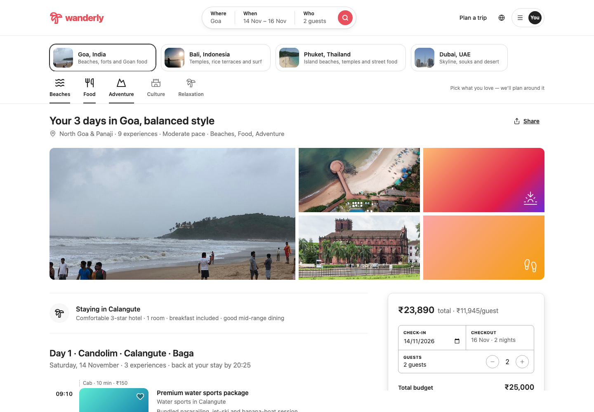
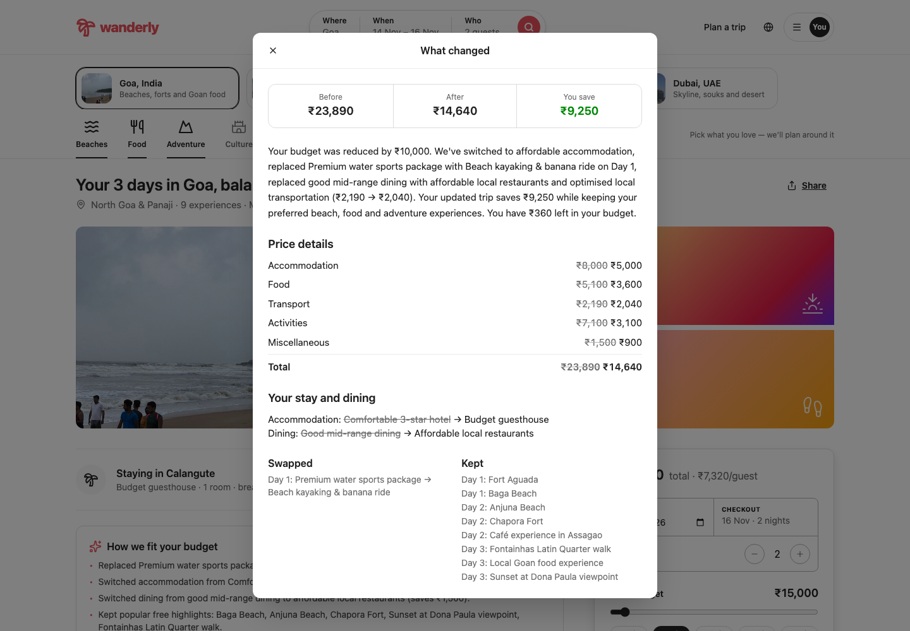

# Wanderly: budget-aware trip planner (MVP)

Plan **3 days in Goa, Bali, Phuket or Dubai** around a fixed budget. You get a timed day-by-day plan with travel, meals and a full cost breakdown. Change the budget and Wanderly rebuilds the trip, keeps whatever still fits, and explains exactly what changed and why.



> All prices, durations and travel times are **illustrative estimates, not live rates**. Flights to and from the destination are **not included**.

---

## Contents

1. [What it does](#what-it-does)
2. [User guide](#user-guide)
3. [Destinations](#destinations)
4. [How the planner works](#how-the-planner-works)
5. [Cost model and assumptions](#cost-model-and-assumptions)
6. [Run it locally](#run-it-locally)
7. [Project structure](#project-structure)
8. [Tests](#tests)
9. [Limitations and roadmap](#limitations-and-roadmap)
10. [Photo credits](#photo-credits)

---

## What it does

| Feature | What you get |
|---|---|
| **Real day plans** | Each day has timed stops, travel legs between them, lunch and dinner. Opening hours are respected and nothing overlaps. |
| **One area per day** | Each day stays in one part of the destination, so travel stays short. |
| **Transparent budget** | Every rupee is traced to a stated rate: stay, food, getting around, activities and extras. |
| **Replan on budget change** | Move the budget and press **Replan trip**. The planner keeps what still fits and makes the smallest set of cuts. |
| **"What changed" explanation** | A before/after price table and a plain-English summary, worked out from the real difference between the two plans (not canned text). |
| **Replace any stop** | Swap one activity for an alternative. The day re-times itself, the cost updates, and your pick is locked in for later replans. |
| **Honest warnings** | If a budget is too small for any workable trip, you are told the minimum it needs. It never goes over budget silently. |
| **Four destinations** | Goa, Bali, Phuket and Dubai, each with its own prices, transport options and 18–19 real places. |

---

## User guide

### 1. Choose a destination

Click a destination card at the top: **Goa**, **Bali**, **Phuket** or **Dubai**. The budget is set to a typical amount for that destination, scaled to your group size. If you already have a plan, it is rebuilt for the new destination straight away.

### 2. Pick what you love

The icon bar under the destinations holds your interests: **Beaches, Food, Adventure, Culture, Relaxation**. Click to turn each one on or off (at least one stays on). Activities that match more of your interests are chosen first. Popular highlights can still appear even if they match none.

### 3. Set dates, guests and budget (card on the right)

- **Check-in:** pick the start date. Checkout is set automatically (3 days, 2 nights).
- **Guests:** use **−** / **+** for 1 to 6 travellers. Rooms are 2 people each; cabs seat 4; scooters carry 2.
- **Total budget:** drag the slider (₹5,000 to ₹2,00,000) or tap a quick chip (₹10k, ₹15k, ₹25k, ₹50k, ₹75k). The line under the button shows the typical budget for 2 at that destination.
- **Travel style:**
  - **Budget:** guesthouses and local food; free and cheap activities score higher.
  - **Balanced:** a comfortable 3-star hotel and mid-range dining.
  - **Luxury:** a resort, fine dining, and premium experiences score higher.
- **Pace:** **Relaxed** (2 activities a day), **Moderate** (3) or **Packed** (4). Meals are extra.
- **Getting around:** three options, named for the destination: Cab / Scooter / Bus in Goa, Ride-hail / Scooter / Shuttle in Bali, Taxi / Scooter / Songthaew in Phuket, Taxi / Rental car / Metro in Dubai.

### 4. Generate the plan

Press **Plan my trip**, or the coral search button in the top bar. You'll see:

- **The header:** the trip title, the area covered, the number of experiences, your pace and interests, and a photo gallery of the destination.
- **Staying in …:** where you're based, the stay type, rooms and dining level. Breakfast is included at the hotel.
- **Day 1–3:** each day's area, date, and the time you'll be back at your stay. For each stop you get:
  - its start time, a photo, its name, category and area;
  - a short description, its cost for the whole group ("Free" if free) and its time slot;
  - a **Guest favourite** badge on popular places;
  - a dashed line before it showing the travel mode, minutes and cost, plus any free time;
  - lunch and dinner in grey rows with their cost.
- **The price card (right):** the total, the cost per guest, and the breakdown (Stay, Food, Getting around, Activities, Extras). It ends with **Left in your budget** in green, or **Over budget by** in red.

### 5. Change the budget and replan (the main feature)

1. Change anything on the right-hand card. Most often that's the budget, for example tap **₹15k**.
2. The button changes to **Replan trip**. Press it.
3. The **What changed** panel opens with:
   - **Before / After / You save** totals;
   - a plain-English summary, for example: *"Your budget was reduced by ₹10,000. We've switched to affordable accommodation, replaced Premium water sports package with Beach kayaking & banana ride on Day 1 … You have ₹360 left in your budget."*;
   - **Price details** by category, old prices struck through;
   - **Your stay and dining**, where the hotel or dining level changed;
   - **Swapped / Removed / Added / Kept**: every activity change, by day.
4. Close it. A **How we fit your budget** box above the itinerary lists each cut and how much it saved. You can reopen the panel any time with **See what changed** on the price card.

Raising the budget brings back upgrades, but never above the travel style you picked.



### 6. Replace a single activity

1. Click **Replace** on any activity card.
2. You get up to 3 alternatives, ranked: same kind of activity first, then same area, then best match to your interests. Each option shows its area, duration, cost and the change to your trip total.
3. Greyed-out options can't fit that day (the reason is shown). Options marked **Puts you over budget** are allowed but flagged.
4. Pick one. The day re-times itself, the totals update and the stop is tagged **Your pick**. Your picks survive later replans, and anything you swapped out stays out.

### 7. When a budget is too small

If no workable trip fits, a red warning gives the cheapest plan's cost and suggests what to change: raise the budget, cut travellers, or choose cheaper transport. The cheapest workable plan is still shown below it.

### 8. Demo shortcuts

| URL | Opens |
|---|---|
| `/#demo` | A ready-made ₹25,000 Goa trip for 2 (Balanced, Moderate, Cab) |
| `/#replan` | The same trip replanned to ₹15,000, with **What changed** open |

**Suggested 5-minute demo:** generate at ₹25,000 → tap ₹15k → **Replan trip** → read the summary → close it, then on Day 3 click **Replace** and pick another stop → switch to **Bali** to show a new destination.

---

## Destinations

| Destination | Based in | Day 1 | Day 2 | Day 3 | Typical for 2* | Getting around |
|---|---|---|---|---|---|---|
| **Goa**, India | Calangute | Candolim · Calangute · Baga | Anjuna · Vagator · Assagao | Panaji · Old Goa · Dona Paula | ₹25,000 | Cab · Scooter · Bus |
| **Bali**, Indonesia | Seminyak | Seminyak · Canggu · Tanah Lot | Ubud · Tegallalang | Uluwatu · Jimbaran · Nusa Dua | ₹40,000 | Ride-hail · Scooter · Shuttle |
| **Phuket**, Thailand | Patong | Patong · Karon · Kata | Phuket Old Town · Chalong | Rawai · Nai Harn · Promthep | ₹40,000 | Taxi · Scooter · Songthaew |
| **Dubai**, UAE | Downtown Dubai | Downtown · Old Dubai | Dubai Marina · JBR · Palm | Jumeirah · Desert | ₹75,000 | Taxi · Rental car · Metro |

\* Balanced style, excluding flights.

**What a typical plan costs** (2 guests, Balanced, Moderate, Cab), and what happens after a 35% budget cut:

| Destination | Budget | Plan cost | Cut to | Replanned cost |
|---|---|---|---|---|
| Goa | ₹25,000 | ₹23,890 | ₹16,250 | ₹16,140 |
| Bali | ₹40,000 | ₹39,530 | ₹26,000 | ₹21,090 |
| Phuket | ₹40,000 | ₹37,160 | ₹26,000 | ₹20,960 |
| Dubai | ₹75,000 | ₹74,200 | ₹48,750 | ₹40,950 |

---

## How the planner works

The engine in `src/engine/` is pure TypeScript: no React, no clock, no randomness. **The same inputs always give the same plan.**

1. **Score** every activity at the destination:
   - **+10** for each of your interests it matches;
   - **+2** if it's a popular highlight;
   - a travel-style bonus. Budget favours free and cheap places; Luxury favours premium ones.
2. **Group:** each day gets one area of the destination.
3. **Pick** the best-scoring activities for each day, up to the pace limit. Two of the same kind (two beaches, two temples) never go on one day.
4. **Schedule** each day:
   - every possible order of the day's stops is tried, with lunch included;
   - opening hours, travel time between stops and meal windows are respected;
   - the order with the least travel wins, then the one with the least idle time.
5. **Cost** the plan from the destination's rates (see below).
6. **Fit the budget:** if the plan is over budget, cuts are applied in this order, least loss of experience first:
   1. swap a premium activity for a cheaper one of the same kind;
   2. move to a cheaper stay;
   3. move to cheaper dining;
   4. swap a paid activity for a free one;
   5. drop a paid activity;
   6. drop the furthest activity.
7. **Explain:** each cut records what it saved. Replans compare the old and new plans to write the "What changed" summary.

Every product rule lives in one file, `src/engine/config.ts`: day hours, meal windows, pace limits, room and vehicle sizes, scoring weights and cut order.

---

## Cost model and assumptions

| Item | How it's worked out |
|---|---|
| **Stay** | rate per room per night × 2 nights × rooms (2 guests per room) |
| **Food** | daily rate per person × 3 days × guests. Lunch ≈ 40% and dinner ≈ 45% of the daily rate; breakfast is at the hotel |
| **Getting around** | per leg, by road distance (straight-line distance × 1.3). Under 1 km is walked for free. Cab: per km with a minimum fare, 4 people per cab. Bus/metro: a flat fare per person per leg. Scooter/rental: a daily rental per vehicle |
| **Activities** | ticket price per person × guests |
| **Extras** | daily allowance per person × 3 days (tips, water, small buys) |

**Day rules:** days run 09:00–21:30 and start and end at your stay. Lunch starts between 12:30 and 14:00; dinner between 19:00 and 20:30.

**Rates by destination** (₹, Budget / Balanced / Luxury):

| | Stay (per room per night) | Food (per person per day) | Extras (per person per day) |
|---|---|---|---|
| Goa | 2,500 / 4,000 / 9,000 | 600 / 850 / 1,800 | 150 / 250 / 500 |
| Bali | 2,500 / 5,000 / 14,000 | 900 / 1,500 / 3,500 | 250 / 400 / 800 |
| Phuket | 2,200 / 4,500 / 13,000 | 1,000 / 1,600 / 3,800 | 250 / 400 / 800 |
| Dubai | 5,500 / 9,000 / 25,000 | 2,000 / 3,200 / 7,000 | 500 / 800 / 1,500 |

---

## Run it locally

Requires Node.js 20.19 or newer (tested on Node 24).

```bash
npm install
npm run dev          # development server → http://localhost:5173
npm test             # run all tests
npm run build        # type-check and production build into dist/
npm run preview      # serve the build → http://localhost:4173
npm run demo         # print the ₹25k → ₹15k → replace journey to the console
```

**Tech stack:** React 19, TypeScript, Vite, Tailwind CSS 4, lucide-react icons, Vitest.

---

## Project structure

```
src/
  App.tsx              UI: header, destination and interest bars, itinerary, price card, pop-ups
  engine/
    planner.ts         generateItinerary, replanItinerary: scoring, selection, budget fitting
    scheduler.ts       fits one day's stops and meals into time slots
    costing.ts         budget breakdown from destination rates
    travel.ts          distance, travel time and cost per leg
    replace.ts         getReplacementOptions, applyReplacement
    diff.ts            compares two plans → "What changed" summary
    config.ts          every product rule in one place
    types.ts           domain types
  data/
    destinations.ts    destination profiles: base, day areas, rates, transport, typical budget
    activities.ts      Goa activities
    bali.ts            Bali activities
    phuket.ts          Phuket activities
    dubai.ts           Dubai activities
    assumptions.ts     shared labels and Goa rates
    photos.json        photo file, source, author and licence per activity
public/photos/         place photos (see CREDITS.md)
tests/                 engine, destination and demo tests
docs/                  README screenshots
PRD.md                 product requirements
architecture.md        technical design
```

---

## Tests

28 tests (`npm test`) check:

- no overlapping stops, opening hours respected, and lunch and dinner on every day;
- the cost breakdown matches an independent hand calculation;
- replans fit the new budget and keep activities that still fit;
- your own picks survive replans;
- budgets too small for any trip get a warning;
- all four destinations generate, replan and offer replacements.

---

## Limitations and roadmap

**MVP limits**
- 4 destinations, fixed 3-day trips.
- Hand-made activity lists with sample prices: no live hotel or ticket prices.
- Flights and airport transfers are not included.
- Plans aren't saved or shareable yet; refreshing the page starts over.

**Next**
- Live hotel and activity prices.
- More destinations and trip lengths.
- Saved and shareable trips.
- Plain-English requests ("make day 2 more relaxed") on top of the same engine.

---

## Photo credits

Place photos in `public/photos/` are from Wikimedia Commons under their own licences (CC BY, CC BY-SA, CC0 and public domain). The source, author and licence of every photo are listed in [CREDITS.md](CREDITS.md). Activities without a suitable photo show an illustrated tile instead.
